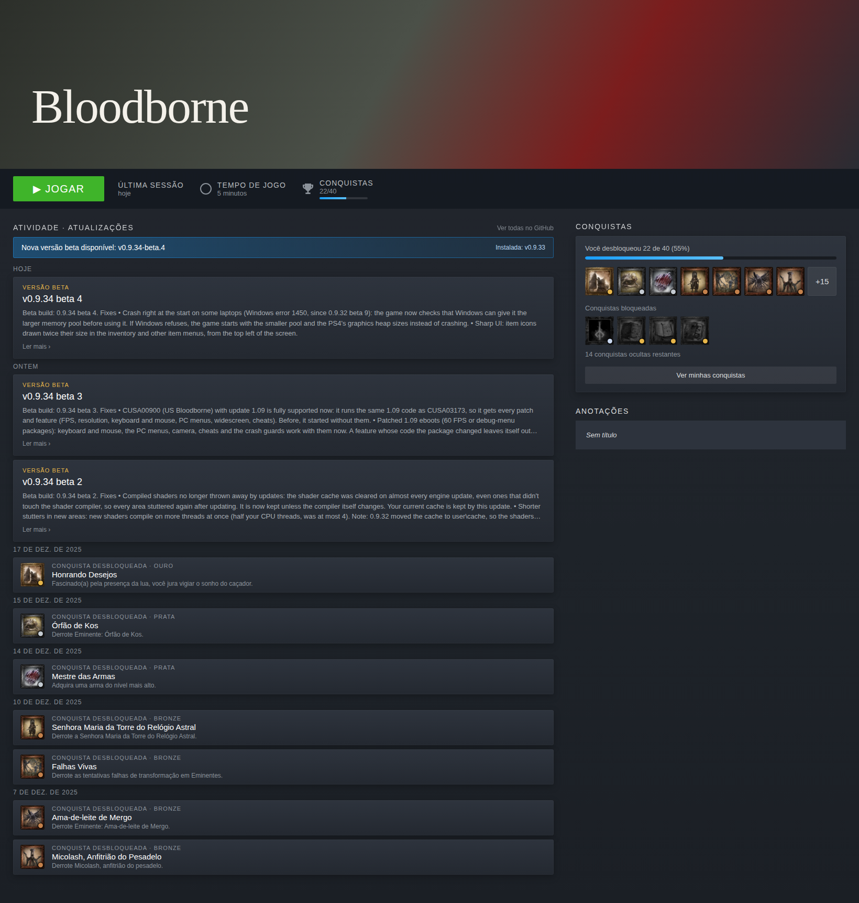

# Bloodborne PC · Biblioteca (plugin Millennium)

Faz a página do atalho não-Steam do **BloodBorneButPc** parecer a de um jogo oficial:

- **Conquistas**: os troféus locais do shadPS4 aparecem com progresso, ícones, raridade (platina/ouro/prata/bronze), troféus ocultos e uma lista completa, em pt-BR quando o Steam está em português.
- **Barra do jogo**: "CONQUISTAS 22/40" ao lado de *Tempo de jogo*.
- **Atividade · Atualizações**: as notas de versão do GitHub do projeto, mais os troféus desbloqueados, por data. Avisa quando há versão nova em relação à instalada.
- Esconde o quadro tracejado "informações indisponíveis por ser um jogo não Steam".

Tudo é **local**. Nada é enviado à Steam, e as conquistas não aparecem no seu perfil público.

## Instalação

1. Instale o [Millennium](https://steambrew.app) (feche o Steam e rode o instalador).
2. Nesta pasta, rode `npm install` e depois `npm run build`. (O `.millennium/Dist/index.js` já vem compilado; só refaça o build se mudar o código.)
3. Com o Steam fechado, rode `install.cmd`.
4. Abra o Steam, vá em **Millennium › Plugins**, ative **Bloodborne PC · Biblioteca** e reinicie quando ele pedir.

O plugin acha a pasta do jogo sozinho, pelo `StartDir`/`Exe` do atalho no `shortcuts.vdf`. Ela precisa conter `user/trophy`.
Ele funciona com qualquer atalho que aponte para uma pasta do shadPS4 com troféus. A seção de atualizações só aparece para o Bloodborne PC.

## De onde vêm os dados

| O quê | Arquivo |
|---|---|
| Desbloqueios e datas | `user/home/<perfil>/trophy/NPWR05818_00.xml`: usa o perfil com mais troféus |
| Nomes traduzidos | `user/trophy/NPWR05818_00/Xml/TROP_17.XML` (pt-BR) |
| Ícones | `user/trophy/NPWR05818_00/Icons/TROPxxx.PNG` |
| Versão instalada | `package.json` da pasta do jogo |
| Atualizações | `api.github.com/repos/Awakenchan/BloodBorneButPc/releases` (cache de 10 min) |

A página se atualiza sozinha a cada ~8 s. Um troféu desbloqueado com o Steam aberto aparece sem precisar recarregar.

## Se algo não aparecer

Os nomes de classe CSS do Steam mudam a cada atualização do cliente. O plugin os resolve pelos módulos do próprio Steam e usa hashes conhecidos (outubro de 2026) como reserva.
Se uma atualização do Steam quebrar a injeção, abra o console do Millennium e procure linhas `[bloodborne-pc]`. Os seletores ficam em `frontend/dom.ts`.
